<!-- ═══════════════════════════════════════════════════════════════
     xhackerip /(reg)ex/ — GitHub profile README
     Assets animés : ./assets/*.svg  ·  Cartes auto : ./profile/*.svg
     ═══════════════════════════════════════════════════════════════ -->

<div align="center">

<a href="https://portfolio-lyart-chi-61.vercel.app/">
  
</a>

<a href="https://portfolio-lyart-chi-61.vercel.app/">
  
</a>

<p>
  
  
  
  
</p>

<p>
  
  <a href="https://github.com/HACKER2025998?tab=followers"></a>
  <a href="https://github.com/HACKER2025998?tab=repositories"></a>
</p>

<p>
  <code><a href="#whoami">WHOAMI</a></code> ·
  <code><a href="#ops">OPS</a></code> ·
  <code><a href="#arsenal">ARSENAL</a></code> ·
  <code><a href="#topology">TOPOLOGY</a></code> ·
  <code><a href="#projects">PROJECTS</a></code> ·
  <code><a href="#path">PATH</a></code> ·
  <code><a href="#telemetry">TELEMETRY</a></code> ·
  <code><a href="#contact">CONTACT</a></code>
</p>

</div>



<a id="whoami"></a>
## `[0x01]` // WHOAMI

<div align="center">
  
</div>

> [!CAUTION]
> **RULES OF ENGAGEMENT** — Tout ce que je fais côté offensif se passe en **labs, CTF ou sur des périmètres explicitement autorisés**. Je casse pour mieux défendre : chaque attaque testée devient une règle, une alerte ou un durcissement.

<details>
<summary><b>📜 &nbsp;cat services.txt</b> — ce que je peux faire pour toi</summary>
<br />

| # | Service | Concrètement |
|:-:|:--|:--|
| 01 | 🌐 **Conception & administration réseau** | LAN/WAN, VPN, routage, VLAN, pare-feu |
| 02 | 🛡️ **Sécurité & DevSecOps** | Durcissement, pipelines CI/CD sécurisés, supervision |
| 03 | ☁️ **Cloud & virtualisation** | AWS, Azure, VMware, Hyper-V, conteneurs & Kubernetes |
| 04 | 🔍 **Cybersécurité & pentest** | Évaluation de vulnérabilités, SIEM/SOC, réponse à incident |

</details>


<a id="ops"></a>
## `[0x02]` // CURRENT OPERATIONS

| MODULE | STATUS | DÉTAILS |
|:--|:-:|:--|
| 🎓 **TRAINING** |  | Licence Administration Systèmes & Réseaux — Université de Lomé `2024 → 2027` |
| 🛠️ **MISSION** |  | Stage Support IT & Administration réseau — Espace Orange Jeune / UNFPA |
| ⚙️ **BUILD** |  | **xutils** & **CyberGuard** — monitoring, SIEM et détection d'intrusions |
| 🧪 **LAB** |  | pfSense · Cisco · Wazuh · Graylog · Nagios · Docker · Kubernetes |
| 📡 **SEEKING** |  | Projets, stages & collabs en réseau, sécurité, DevSecOps |
| 🎯 **CHALLENGE** |  | Subnetting · SSH · analyse de logs → [relève le défi (300 pts)](https://portfolio-lyart-chi-61.vercel.app/) |


<a id="arsenal"></a>
## `[0x03]` // ARSENAL

<div align="center">

<table>
  <tr>
    <td align="center" width="130"><b><code>LANG</code></b></td>
    <td></td>
  </tr>
  <tr>
    <td align="center"><b><code>BACKEND</code></b></td>
    <td></td>
  </tr>
  <tr>
    <td align="center"><b><code>SYS · CLOUD</code></b></td>
    <td></td>
  </tr>
  <tr>
    <td align="center"><b><code>DEVOPS</code></b></td>
    <td></td>
  </tr>
</table>

<b><code>// NETSEC TOOLKIT</code></b><br /><br />


<br />


<br />


<br />


</div>


<a id="topology"></a>
## `[0x04]` // LIVE TOPOLOGY

<div align="center">
  
  <sub><i>Trafic légitime routé vers les VLANs · bruteforce bloqué par l'ACL du pare-feu · logs remontés au SIEM.</i></sub>
</div>


<a id="projects"></a>
## `[0x05]` // PROJECTS

<table>
  <tr>
    <td width="50%" valign="top">
      <h3>⚙️ xutils</h3>
      <p>Installe et configure des solutions de <b>monitoring & SIEM</b> (Nagios, Wazuh, Graylog) sur des machines locales ou distantes — plus un <b>assistant web</b> DevOps pour guider l'installation.</p>
      
      
      
      <p><a href="https://github.com/HACKER2025998/xutils">📂 Code</a> · <a href="https://github.com/HACKER2025998/xutils-assistant">📂 Assistant</a> · <a href="https://xutils-assistant.vercel.app">🚀 Live</a></p>
    </td>
    <td width="50%" valign="top">
      <h3>🛡️ CyberGuard</h3>
      <p>SIEM de supervision des performances <b>système & réseau</b> et de <b>détection d'intrusions</b>, avec gestion des risques et des événements assistée par IA.</p>
      
      
      
      <p><a href="https://github.com/HACKER2025998/cyberguard">📂 Code</a></p>
    </td>
  </tr>
  <tr>
    <td width="50%" valign="top">
      <h3>🧰 NetSecOps — Cyber Toolkit</h3>
      <p>Calculateurs <b>VLSM / FLSM</b>, outils réseau et guides systèmes & cybersécurité, réunis dans une boîte à outils en ligne.</p>
      
      
      <p><a href="https://netapp-eight.vercel.app">🚀 Live</a></p>
    </td>
    <td width="50%" valign="top">
      <h3>📡 OutilsCisco</h3>
      <p>Mini-site d'utilitaires réseau : calculateurs <b>VLSM</b> et <b>EUI-64</b> pour aller vite en conf Cisco.</p>
      
      
      <p><a href="https://github.com/HACKER2025998/OutilsCisco">📂 Code</a></p>
    </td>
  </tr>
  <tr>
    <td width="50%" valign="top">
      <h3>🛒 Shop Smartly</h3>
      <p>Application e-commerce : catalogue, catégories, favoris, panier et comptes clients.</p>
      
      
      <p><a href="https://github.com/HACKER2025998/shop-smartly">📂 Code</a> · <a href="https://shop-smartly-five.vercel.app">🚀 Live</a></p>
    </td>
    <td width="50%" valign="top">
      <h3>🏢 GLPI @ UNFPA</h3>
      <p>Stage TIC : gestion de parc informatique et helpdesk avec <b>GLPI</b> — inventaire, tickets, suivi des interventions.</p>
      
      
      <p><a href="https://portfolio-lyart-chi-61.vercel.app/">🔗 Détails sur le portfolio</a></p>
    </td>
  </tr>
</table>


<a id="path"></a>
## `[0x06]` // PATH.LOG

<div align="center">
  
</div>


<a id="telemetry"></a>
## `[0x07]` // TELEMETRY

<div align="center">

<p>
  
  
</p>

<p>
  
</p>

<p>
  
</p>

<picture>
  <source media="(prefers-color-scheme: dark)" srcset="./profile/snake-dark.svg" />
  <source media="(prefers-color-scheme: light)" srcset="./profile/snake-light.svg" />
  
</picture>

</div>


<a id="contact"></a>
## `[0x08]` // OPEN A CHANNEL

<div align="center">

<a href="https://portfolio-lyart-chi-61.vercel.app/"></a>
<a href="https://www.linkedin.com/in/bernard-kossi-etonam-adjogble-92a6803a8"></a>
<a href="mailto:adgjogblebernard229@gmail.com"></a>
<br />
<a href="https://www.youtube.com/@xhackerip228"></a>
<a href="https://www.tiktok.com/@xhackerip"></a>
<a href="https://www.instagram.com/xhackerip"></a>

</div>

```bash
┌──(xhackerip㉿warzone)-[~]
└─$ ./disconnect.sh --graceful
[*] Sauvegarde de la session ............ OK
[*] Effacement des traces ............... lol non, c'est un README 😄
[+] Merci pour la visite. Un repo t'a aidé ? Laisse une ⭐
[+] Connection closed by xhackerip — build to warzone.
```


